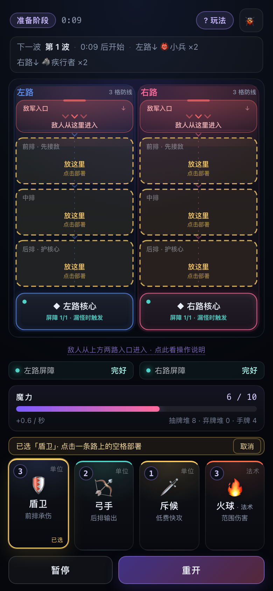
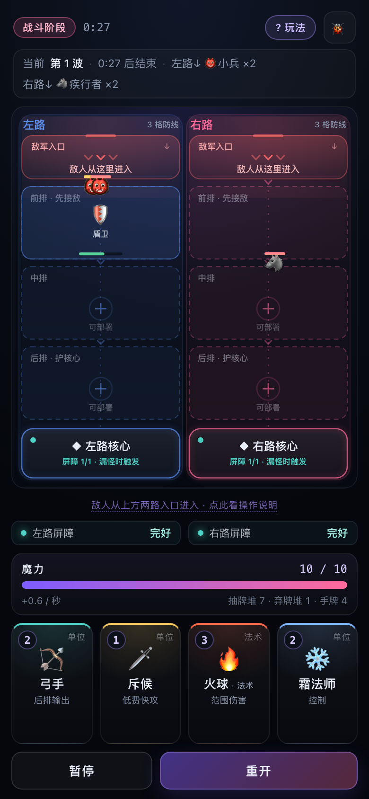
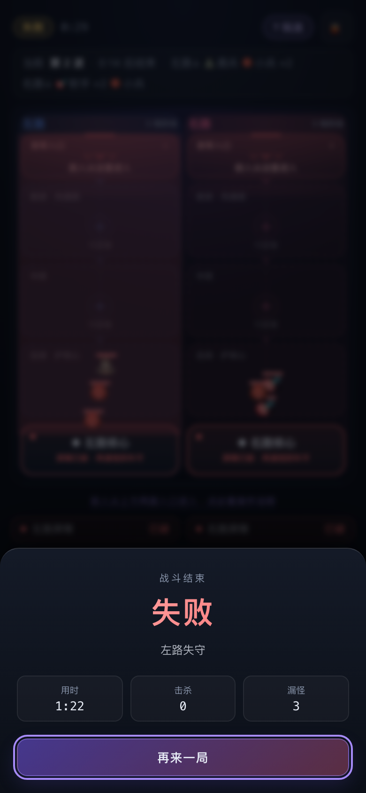
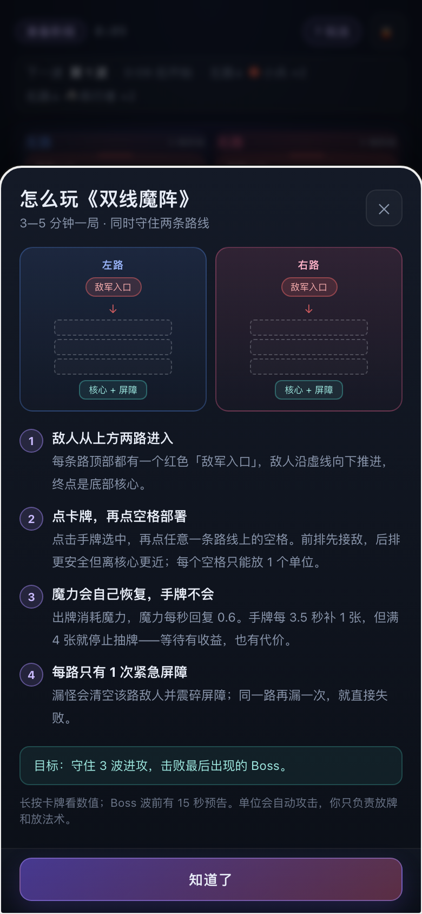

# 双线魔阵（Double-Lane Arcane Grid）

竖屏双路线、低频操作的即时卡牌塔防原型：敌人从上方两路推进，玩家用自动恢复的魔力在 **2 路 × 3 格** 防线中部署单位、释放法术，守住底部核心。

当前版本：**M1 核心可玩**。完整一局已能跑通：选牌 → 点格部署 → 单位自动战斗 → 法术救场 → 每路 1 次屏障 → 3 波 + Boss → 胜负结算。数值仍按 GDD V0.1 初版，待 M4 调优。

## 界面预览

| 选择单位：合法格高亮 | 战斗中：单位 / 敌人 / 血条 |
|---|---|
|  |  |

| 失败结算 | 玩法说明 |
|---|---|
|  |  |

## 快速开始

**双击启动（推荐）**

- macOS：双击 `start.command`（首次如提示无权限，执行一次 `chmod +x start.command`）
- Windows：双击 `start.bat`

脚本会自动检查 Node.js、首次运行时安装依赖，然后启动开发服务器并打开浏览器。

**命令行**

```bash
npm install
npm run dev        # http://127.0.0.1:5173
npm test           # 单元测试（数据表 + 经济 + 战斗，32 项）
npm run typecheck  # tsc --noEmit
npm run build      # 类型检查 + 静态构建到 dist/
```

## 操作方式

- **单位卡**：点击手牌选中 → 点击任意一条路线上的空格部署；合法格会亮起「放这里」。
- **法术卡**：点击选中 → 点击目标格释放；「冰霜新星」「魔力涌动」选中后立即生效。
- **长按卡牌**：查看完整数值与定位说明。
- **暂停**：`暂停` 按钮或空格键；暂停时不能出牌。
- **重开**：`重开` 按钮，生成新种子并重置整局。
- **调试**：右上角 🐞 显示种子、阶段、实体数、牌堆、Boss 进度与画布尺寸。

## 目录结构

```
src/
  core/        纯类型与工具：Lane/Row/Cell、格子校验、可复现随机
  data/        全部可调数值：卡牌、敌人、波次、卡组、全局 tuning
  sim/         纯逻辑内核（不依赖 DOM）：state / economy / entities / battle
  ui/
    render/    Canvas 战场绘制（单位、敌人、法术特效、DPR 适配）
    dom/       顶部 HUD、手牌、卡牌详情、玩法说明
  styles/      基础色板、布局、手牌、结算
  main.ts      装配入口 + 1/60 固定步长循环 + 输入
tests/         Vitest 单元测试
docs/          GDD、架构说明、里程碑、界面截图
```

设计约束：`sim/` 与 `data/` 不 import DOM，保证同一套规则可被浏览器与无头模拟（1000 局平衡跑批）复用。

## 文档

- [策划案 docs/GDD.md](docs/GDD.md) — 玩法、数值、波次、验收标准
- [架构说明 docs/architecture.md](docs/architecture.md) — 数据流、1/60 固定步长、模块边界
- [里程碑 docs/roadmap.md](docs/roadmap.md) — M0–M4 进度

## 核心规则速查

| 项目 | 数值 |
|---|---|
| 战场 | 2 路 × 3 格，行 0 前排 / 行 2 后排 |
| 魔力 | 上限 10，初始 5，恢复 0.6/s |
| 手牌 | 上限 4，每 3.5s 抽 1 张，满手停止抽牌 |
| 卡组 | 12 张固定（盾卫 ×2、弓手 ×2、其余 8 种各 1） |
| 波次 | 3 波 + Boss，约 3.5–4.5 分钟 |
| 容错 | 每路 1 次紧急屏障，第二次漏怪判负 |

## 里程碑

- **M0 骨架** ✅：工程配置、数据表、可读性战场、玩法说明、经济系统 + 单测
- **M1 核心引擎** ✅：固定步长、部署 / 推进 / 阻挡 / 攻击、12 张卡、屏障与胜负、最小交互与结算
- **M2 渲染与交互** 🚧：单位 / 敌人 / 法术特效 / 暂停 / 重开已完成；剩余拖拽部署与更细的命中反馈
- **M3 完整内容** 🚧：3 波 + Boss、路线预告、跳路者、Boss 蓄力已接入；待整体验收
- **M4 测试调优**：模拟跑批、试玩、数值调整
